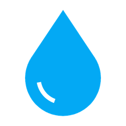

# Water Reminder for Home Assistant

A small hydration reminder: every N minutes a push notification asks you to drink.
No YAML, no helpers – everything is set up and controlled in the UI.

## Features

- **Interval** adjustable (default 30 min), aligned to the clock: with 30 min the reminders
  come at hh:00 and hh:30. Intervals that do not divide a day restart at midnight.
- **Several targets:** send to one or more devices with the Companion app.
- **Test button** sends a reminder right away – unless it is off, paused or quiet; then it
  tells you why.
- **Apple Watch first:** the push goes to your iPhone; iOS shows it on the Watch while you
  wear it and the iPhone is locked, otherwise on the iPhone
  ([Apple](https://support.apple.com/en-in/HT204791)).
- **Disappears by itself** after 60 s (configurable, 0 = keep). Each new reminder replaces
  the previous one, so there is never more than one.
- **Quiet** while the alarm panel is in selected states (default: `armed_night`)
  or while the *Quiet (Focus)* switch is on.
- **Actions in the notification:** `OK` (dismiss, also on the Watch), `Pause for 1 h`,
  `Pause for 3 h`, `Pause for today`. Pausing also works with buttons in HA,
  plus *Resume*.

## Installation

1. Home Assistant → **Settings → Marketplace** → add this repository by its link
   (`https://github.com/TheBigNeo-AI/HomeAssistant-Water-Reminder`) and install *Water Reminder*.
2. **Settings → Devices & services → Add integration → Water Reminder**.
3. Pick your iPhone's notify service (`notify.mobile_app_…`, more targets possible) and,
   optionally, your alarm panel.

The first install loads without a restart; updates need a Home Assistant restart, because
Python code that is already loaded cannot be replaced at runtime (dashboard cards only need a
browser reload, integrations do not have that option).

Requires the Home Assistant Companion app. For the pause buttons on the Watch, install the
Home Assistant Watch app.

## Entities

| Entity | Purpose |
| --- | --- |
| `switch.water_reminder` | Reminder on/off |
| `switch.water_reminder_quiet_focus` | Suppress reminders (set by iOS Shortcuts) |
| `number.water_reminder_interval` | Interval in minutes |
| `sensor.water_reminder_status` | `active`, `paused`, `quiet_alarm`, `quiet_focus`, `off` |
| `sensor.water_reminder_next_reminder` | Time of the next reminder |
| `sensor.water_reminder_paused_until` | End of the current pause |
| `button.water_reminder_send_test` | Send a reminder now (respects off / pause / quiet) |
| `button.water_reminder_pause_1_h` / `_3_h` / `_today` / `resume` | Pause / resume |

Targets, alarm panel, quiet states, removal delay and texts: **Configure** on the integration.

## Focus modes (Sleep, Cinema, …)

Home Assistant only knows *whether* a Focus is on, not *which*. Create one iOS Shortcuts
personal automation per Focus:

1. Shortcuts → Automation → **New** → **Focus** → e.g. *Sleep* → *When turning on* → *Run immediately*.
2. Action: Home Assistant → **Control switch** → `switch.water_reminder_quiet_focus` → *On*.
3. Repeat with *When turning off* → *Off*.

Personal automations are device-specific and cannot be shared or imported
([Apple](https://support.apple.com/guide/shortcuts/apdf01f8c054/ios)), so they have to be
created on each device. Only regular shortcuts can be shared via iCloud link.

## Known limitation

Removing delivered notifications (`clear_notification`) is currently unreliable on some iOS
Companion versions ([home-assistant/iOS#4304](https://github.com/home-assistant/iOS/issues/4304)).
If a reminder stays, the next one replaces it.

## Development

See [DEVELOPERS.md](DEVELOPERS.md) for versioning, local tests, testing a pre-release and
the release steps.
